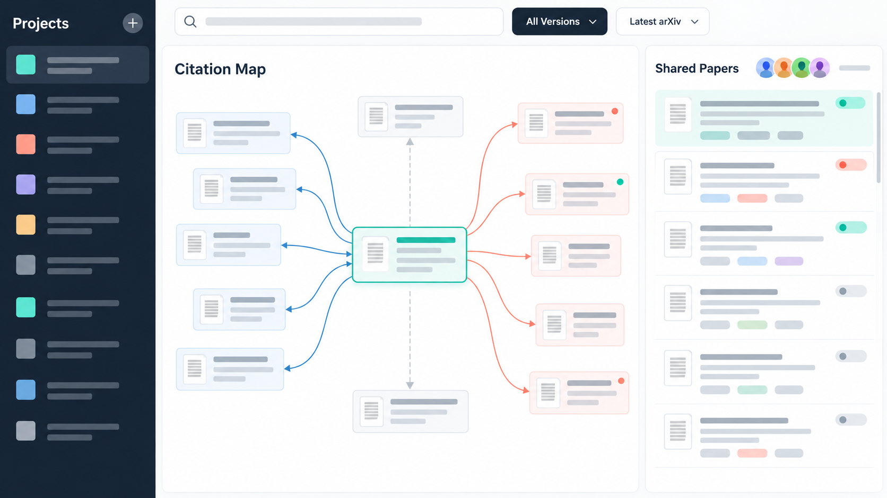

# 논문 인용 관계 탐색 및 공동 문헌 조사 서비스

## 1. 프로젝트명

**논문 인용 관계 탐색 및 공동 문헌 조사 서비스**

## 2. 프로젝트 주제 및 비즈니스 모델

논문과 논문 사이의 인용 관계를 탐색해 선행 연구를 찾고, 찾은 논문을 연구팀의 공동 프로젝트에 모아 함께 관리하는 웹 서비스다. 프로젝트 구성원들은 논문 목록을 공유하고 검토 상태, 태그, 메모를 함께 관리한다.

비즈니스 모델은 프리미엄 구독형을 검토한다. 논문 검색, 직접 인용·피인용 목록 조회, 공동 프로젝트의 기본 관리는 기본 기능으로 제공하고, 여러 단계의 인용 관계를 그래프로 시각화하고 상세 필터로 탐색하는 기능은 유료 구독 기능으로 제공하는 안이다. 이는 초기 수익 모델 가설이며, 실제 요금과 구독·결제 처리는 이번 학기 구현 범위에 포함하지 않는다.

## 3. 해결하고자 하는 문제

- 특정 논문이 참고한 선행 연구와 해당 논문을 인용한 후속 연구를 연속적으로 찾기 번거롭다.
- 공동 연구자들이 참고 논문과 검토 내용을 각자 다른 곳에 정리해 자료가 흩어지거나 중복될 수 있다.
- 같은 연구가 arXiv 업데이트와 학회·저널본으로 나뉘어 공개되면 어떤 판본을 볼지 구분하기 어렵다.

## 4. 주요 사용자

- 논문을 공동 작성하거나 선행 연구를 함께 조사하는 대학원생 및 연구자 팀
- 특정 연구 주제의 선행·후속 논문을 찾는 학부생과 연구자
- 지도교수 및 공동연구자와 문헌 목록을 공유하려는 연구팀

## 5. 핵심 기능

- 논문이 인용한 논문과 해당 논문을 인용한 논문을 탐색한다.
- arXiv 각 업데이트, 학회본, 저널본을 별도 논문 기록으로 관리하고, 관련 판본을 연결한다.
- 탐색 화면에서 학회·저널본만 보기, 최신 arXiv본 보기, 전체 판본 보기를 선택한다.
- 연구 프로젝트를 만들고 구성원을 추가해 공동 논문 목록을 공유한다.
- 프로젝트 안에서 논문 검토 상태, 태그, 메모를 함께 관리한다.
- 제목, 저자, 출판처, 연도, DOI·arXiv ID로 논문을 검색하고 필터링한다.

## 6. 예상 테이블 구성 및 데이터 구조

아래 14개 테이블을 핵심 후보로 설계한다. 논문과 저자·출판처·인용 관계를 나누어 저장하고, 프로젝트·사용자 및 논문·태그 사이의 다대다 관계는 연결 테이블로 표현한다.

| 테이블 | 한 행의 의미 | 주요 키 및 관계 후보 |
| --- | --- | --- |
| `users` | 서비스를 사용하는 연구자 한 명 | PK `user_id`; 이메일 UNIQUE 후보 |
| `research_projects` | 연구팀의 문헌 조사 프로젝트 하나 | PK `project_id`; FK `created_by_user_id` → `users` |
| `project_members` | 한 사용자가 한 프로젝트에 참여하는 관계 하나 및 역할 | 복합 PK (`project_id`, `user_id`); 두 FK로 프로젝트와 사용자 참조 |
| `project_papers` | 프로젝트가 논문 기록 하나를 공동 문헌 항목으로 포함한 관계 하나 | 복합 PK (`project_id`, `paper_id`); FK로 프로젝트와 논문 참조; 추가한 사용자 기록 |
| `papers` | 인용·검색 대상이 되는 논문 공개 기록 하나. arXiv 업데이트, 학회본, 저널본을 각각 저장 | PK `paper_id`; 논문 유형·판본·제목·공개일; FK `venue_id` → `venues` 후보 |
| `paper_identifiers` | 논문 기록을 가리키는 DOI 또는 arXiv ID 하나 | PK `identifier_id`; FK `paper_id` → `papers`; 식별자 종류와 값 UNIQUE 후보 |
| `paper_relations` | 두 논문 기록 사이의 업데이트·출판 판본 관계 하나 | PK `relation_id`; 두 FK 모두 `papers` 참조 |
| `authors` | 저자 한 명 | PK `author_id`; ORCID UNIQUE 후보 |
| `paper_authors` | 한 저자가 한 논문 기록에 참여한 관계 하나 및 저자 순서 | 복합 PK (`paper_id`, `author_id`); FK로 논문과 저자 참조 |
| `venues` | 학회 또는 학술지 하나 | PK `venue_id` |
| `citations` | 한 논문 기록이 다른 논문 기록을 인용하는 관계 하나 | PK `citation_id`; 인용 논문·피인용 논문 FK 모두 `papers` 참조 |
| `project_tags` | 한 프로젝트에서 사용하는 태그 하나 | PK `tag_id`; FK `project_id` → `research_projects` |
| `project_paper_tags` | 프로젝트의 논문 항목에 태그를 연결한 관계 하나 | 복합 PK (`project_id`, `paper_id`, `tag_id`); 프로젝트 논문 및 태그 참조 |
| `paper_notes` | 프로젝트 논문 항목에 구성원이 작성한 메모 하나 | PK `note_id`; FK로 프로젝트 논문, 작성 사용자 참조 |

`project_members`는 사용자와 프로젝트의 다대다 관계 및 구성원 역할을 나타낸다. `project_papers`는 프로젝트와 논문의 다대다 관계를 나타낸다. `citations`는 논문 테이블을 인용 논문과 피인용 논문으로 두 번 참조한다. `paper_relations`는 판본 간 관계를 저장하며 실제 참고문헌 인용 관계와 구분한다.

## 7. 향후 구현 계획

1. 2차 고도화: 프로젝트 생성 → 구성원 추가 → 논문 검색·인용 탐색 → 공동 목록 등록의 사용자 흐름과 주요 화면을 구체화한다. ERD 초안을 작성하고 피드백에 따른 테이블·관계 변경 사항을 기록한다.

2. 3차 분석·설계: 최종 ERD와 테이블 명세를 작성하고 PK/FK, 자료형, 정규화, 무결성 제약조건을 확정한다. 검색·JOIN·집계·서브쿼리 SQL을 설계하고 인덱스와 트랜잭션 적용 지점을 정리한다.

3. 4차 구현·발표: PostgreSQL 연동 웹 애플리케이션에서 논문 CRUD·검색, 인용 관계 탐색, 판본 필터, 공유 프로젝트와 구성원별 역할, 태그·메모 관리를 구현하고 샘플 데이터로 검증한다. 주요 SQL과 설계 변경 이유를 시연한다. 구독·결제 기능은 구현 범위에서 제외한다.
